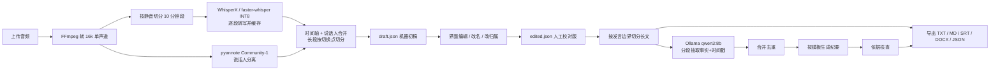

# 本地访谈转录与 AI 会议纪要系统

一套完全在本机运行的 Windows 桌面级 Web 应用：上传中文 / 日语访谈录音 → CPU 语音识别 →
本地说话人分离 → 可编辑的时间戳逐字稿 → 本地 Ollama 生成有原文证据的结构化纪要 → 导出
TXT / Markdown / SRT / DOCX / JSON。

- 不使用任何云 API、不需要 NVIDIA 显卡、不依赖 CUDA。
- 音频与文字全部保存在 `projects/` 下，服务只监听 `127.0.0.1`。
- 首次运行需要联网下载模型（Hugging Face / Ollama），之后可断网使用。



---

## 1. 已验证的运行环境

| 项目 | 值 |
| --- | --- |
| 操作系统 | Windows 11 (10.0.26200) |
| CPU | Intel Core i5-1235U（10 核 / 12 线程，无 CUDA） |
| 内存 | 31.8 GB |
| GPU | Intel Iris Xe（未使用，纯 CPU 推理） |
| Python | 3.13.14 (venv) |
| PyTorch | 2.8.0+cpu |
| WhisperX | 3.8.6（faster-whisper 1.2.1 / CTranslate2 4.8.5，INT8） |
| pyannote.audio | 4.0.7（`pyannote/speaker-diarization-community-1`） |
| Ollama | 0.40.13，模型 `qwen3:8b` (Q4_K_M) |
| FFmpeg | BtbN master build（随 `tools/ffmpeg` 分发） |
| Web | FastAPI 0.118 + 原生 JS（无 CDN，可离线） |

> 说明：需求里提到 Python 3.11，本机只有 3.13。上述组合已在 3.13 上完整跑通，
> 因此 `requirements.txt` 按 3.13 锁定；3.11/3.12 同样在 whisperx 3.8.6 的
> `>=3.10,<3.14` 支持范围内，但**未在本机逐项验证**。

---

## 2. 三分钟开始

```powershell
cd C:\src\speech_conversion

# 1) 安装（下载 FFmpeg、创建 .venv、装依赖、可选安装 Ollama 并拉取 qwen3:8b）
powershell -ExecutionPolicy Bypass -File .\install.ps1

# 2) 启动（自动打开 http://127.0.0.1:7860）
powershell -ExecutionPolicy Bypass -File .\start.ps1
```

首次使用「说话人分离」前，需要在网页右上角 **设置** 中填写 Hugging Face Token：

1. 在 <https://huggingface.co/pyannote/speaker-diarization-community-1> 点击同意条款；
2. 在 <https://huggingface.co/settings/tokens> 创建 Read Token；
3. 粘贴到设置页（只写入 `secrets/hf_token.txt`，不回显、不写日志）。

详细操作见 [`docs/使用手册.md`](docs/使用手册.md)。

---

## 3. 功能实现状态（对需求逐条）

### A. 音频导入与管理 ✅

- 拖放 / 选择上传，支持 M4A、MP3、WAV、FLAC、AAC、OGG、OPUS、WMA、MP4、MOV、WebM、AMR、AIFF
- 用 ffprobe 读取格式、时长、大小、采样率、声道、码率
- 语言（自动 / 中文 / 日语 / 英语）、模型（medium / large-v3）、说话人数（自动或 1–5）、
  计算精度、线程数、batch、beam 均可设置
- 实时进度（阶段 + 百分比 + 日志）、取消任务、断点续跑、历史项目自动恢复

### B. 高准确率转录 ✅（合成音频验证）

- WhisperX → faster-whisper/CTriangle2，CPU INT8
- 按静音位置切分为约 10 分钟的分段，逐段识别并缓存（`asr/chunks/NNN.json`）
- 保留原始识别文本，不做摘要、不补写；置信度低的段落在界面标记「低置信度」
- 时间戳来自 VAD + Whisper 解码；可选 wav2vec2 强制对齐获得词级时间戳
- 中日混说：可手动指定主语言；**句内自动切换语言不可靠**（见限制）
- **不使用 `initial_prompt`**：实测它会被 Whisper 当作音频内容复读（例如整段变成
  「请用简体中文并加上标点符号」）。历史稿件可用「重建逐字稿（清理异常段落）」清除
  （只改初稿，`asr/chunks` 里的原始结果保留）

### C. 说话人区分 ✅（代码完成，模型需 HF Token 才能实跑）

- 本地 pyannote Community-1，`num_speakers` / `min..max` 可指定
- 按“时间重叠最大者优先”把说话人写回每句话，并在说话人切换处切分长段
- 标记「说话人不确定 / 疑似重叠 / 无分离结果」
- **二次声纹校验**：重新提取每个 turn 的声纹并全局聚类，纠正 pyannote 偶发的两人短暂对调
  （不重新识别、不重跑分离；38 分钟录音实测 51.5 s，纠正 48/916 个 turn，原结果自动备份）
- 支持改名（访谈者 / 受访人）、逐段修改归属、仅重跑说话人分离而不重新识别
- 原始分离结果保存在 `diarization/raw.json`（含全部 turn），不覆盖

> ✅ 已用真实模型在 40 秒中文片段上跑通：模型加载 11.7 s、分离 13.7 s，识别出 2 位说话人
> （约 0.34× 实时）。真实访谈中的短插话与重叠语音准确率仍需你自己评估。见 `docs/测试报告.md`。

### D. 完整逐字稿 ✅

- 每段显示 `[HH:MM:SS]` 与说话人，文本可直接编辑
- 版本下拉可切换「机器初稿 / 人工校对版」；对齐、重建、声纹校验只重写初稿，
  已有校对版时界面会提示「机器初稿已更新」并一键查看新初稿
- 音频播放器 + 点击时间戳跳转播放并高亮对应段落
- 机器初稿 `draft.json` 与人工校对版 `edited.json` 分开保存，重跑识别不会覆盖人工修改
- 修改说话人或文本后可随时导出，导出时可选版本
- 导出 TXT / Markdown / SRT / DOCX / JSON（JSON 含分段与词级时间戳）

### E. AI 结构化纪要 ✅

- 本地 Ollama（默认 `qwen3:8b`），通过 `http://127.0.0.1:11434` 调用
- 两种模板，章节与需求完全对应（普通会议 / 定性研究访谈，见 `summarization/prompts.py`）
- 强制输出证据时间戳、禁止编造、原文未提及需明说
- 日语等重要引述保留原文 + 中文翻译
- 生成后可选「依据核查」：让模型逐条检查结论是否有证据支持并列出存疑项

### F. 长访谈处理 ✅

- 按时间戳与发言边界切分（默认 4500 字符，可在设置中调整）
- 每段独立抽取「事实 + 时间戳 + 原文引用」，结果落盘可续跑
- 事实过多时分组分层合并去重，再压缩到模型上下文预算内
- 逐字稿过长时不会整段硬塞给模型，也不依赖自动截断

### G. 图形界面 ✅

- 项目列表（新建 / 打开 / 重命名 / 删除）
- 音频转录（设置、进度、日志、取消、重跑分离）
- 逐字稿编辑（播放器、时间戳、说话人下拉、可编辑文本、说话人改名、保存）
- AI 纪要（模板、模型、生成/重生成、人工编辑、时间戳跳回逐字稿）
- 导出（逐字稿 / 纪要 / JSON / DOCX）

---

## 4. 目录结构

```
.
├─ app/                     Web 服务与业务层
│  ├─ main.py               启动入口（uvicorn，仅 127.0.0.1）
│  ├─ server.py             FastAPI 路由 + 音频 Range 流
│  ├─ pipeline.py           标准化 → ASR → 分离 → 合并
│  ├─ audio.py              FFmpeg 封装（probe / 转码 / 静音切分）
│  ├─ projects.py           项目 CRUD 与目录布局
│  ├─ transcript.py         初稿 / 校对版读取与保存
│  ├─ jobs.py               单线程任务队列（进度 / 日志 / 取消）
│  ├─ config.py             路径、FFmpeg 发现、Token、默认参数
│  └─ static/               前端（HTML/CSS/JS，无外部依赖）
├─ transcription/
│  ├─ asr.py                WhisperX 封装
│  ├─ diarization.py        pyannote 封装
│  ├─ recluster.py          二次声纹校验（重新聚类 turn 声纹）
│  └─ merge.py              说话人对齐、长段切分、段落合并
├─ summarization/
│  ├─ ollama_client.py      Ollama HTTP（流式、JSON schema）
│  ├─ chunking.py           证据格式化与分段
│  ├─ prompts.py            两种模板与提示词
│  └─ summarize.py          map → reduce → compose → verify
├─ exporters/               TXT / MD / SRT / DOCX / JSON
├─ tests/                   81 个自动化测试 + 合成音频夹具
├─ tools/                   安装辅助脚本、端到端验证脚本
├─ projects/                每个访谈一个目录（运行时生成）
├─ models/                  Whisper / pyannote / HF 缓存
├─ requirements.txt
├─ install.ps1 / start.ps1
└─ docs/                    使用手册、测试报告、功能与限制
```

单个项目的目录布局：

```
projects/<20261103-113838-6baa9f>/
  project.json              元数据、设置、阶段状态、说话人名称
  audio/source.wav          原始录音（只读）
  audio/normalized_16k.wav  转码缓存
  asr/manifest.json         切分计划与参数指纹
  asr/chunks/000.json       每段识别结果（断点续跑）
  diarization/raw.json      说话人分离原始输出
  transcript/draft.json     机器初稿
  transcript/edited.json    人工校对版
  summary/chunks/NNN.json   分段事实抽取缓存
  summary/final.json        最终纪要 + 证据 + 核查结果
  summary/final.md
  logs/job.log, timings.json
```

---

## 5. 关键设计说明

**为什么不用 `whisperx.diarize`？**
WhisperX 3.8.6 的 `DiarizationPipeline` 依赖 `load_audio`（torchcodec/ffmpeg）。
本应用直接调用 pyannote `Pipeline`，传入内存中的 waveform 字典，绕开 torchcodec。
（torchcodec 0.7 仅支持 FFmpeg ≤ 7，而 Windows 上没有匹配的 shared build，属上游限制。）

**为什么切分 10 分钟分段？**
CPU 推理下长录音需要可观测的进度、可控的内存和断点续跑；分段结果按
`model+compute_type+language+beam+align+prompt_version` 做指纹缓存，改设置才会失效。

**怎样保证纪要“有依据”？**
1. 抽取阶段只允许把事实写成「statement + time + 逐字引用」；
2. 合成阶段只拿事实 JSON，不拿原始全文，避免模型自由发挥；
3. 可选核查阶段让模型逐条判断结论是否有证据、时间戳是否对得上。

**为什么用 FastAPI + 原生 JS 而不是 Gradio/Streamlit？**
逐字稿编辑需要「音频定位 + 逐段编辑 + 说话人下拉 + 自动保存 + 纪要时间戳回跳」，
这些在原生前端里更可控、也不引入大版本升级风险；页面无任何外部 CDN，可离线使用。

---

## 6. 测试

```powershell
# 全部自动化测试（不需要模型、不需要联网）
python -m pytest tests -q
# 或
tools\run_tests.cmd
```

```
81 passed
```

覆盖：说话人对齐/切分、二次声纹校验（聚类与翻转门限）、提示词复读与重复循环过滤、
分段策略、SRT/TXT/MD/DOCX/JSON 导出、项目 CRUD、
初稿/校对版覆盖与陈旧检测、HTTP API（含 Range 请求、上传、导出、Token 不回显）、
FFmpeg 转码与静音切分、Ollama map/reduce/compose（桩）、真实 WhisperX 端到端转录、真实 qwen3:8b 纪要生成。

详细结果与耗时见 [`docs/测试报告.md`](docs/测试报告.md)。

---

## 7. 实测性能（本机，i5-1235U / 12 线程 / 无 GPU）

| 阶段 | 实测 | 说明 |
| --- | --- | --- |
| FFmpeg 转码 2:46 音频 | < 1 s | 16k 单声道 |
| WhisperX medium / int8 | 49.8 s | RTF 0.30（约 3 倍实时） |
| WhisperX large-v3 / int8 | 106.9 s / 137.5 s | RTF 0.64–0.83（同段 2:46 样本，约为 medium 的 1.4–1.8 倍耗时） |
| WhisperX 模型加载 | 9.1 s（medium）/ 20.1 s（large-v3，权重已缓存） | 首次下载 large-v3 的加载为 190.6 s |
| ASR 常驻内存 | 1.3 GB（medium）/ 2.1 GB（large-v3，加载峰值 3.7 GB） | 本机 31.8 GB 内存充足 |
| pyannote 分离（40 s 样本） | 13.7 s | 约 0.34× 实时；模型加载 11.7 s |
| 强制对齐（wav2vec2，2:46 样本） | 80.8 s | 约 **0.49× 实时**（模型已缓存时） |
| 强制对齐（38:15 真实访谈，4 分段） | 508.4 s | **0.22× 实时**；只补词级时间戳，不重新识别 |
| 二次声纹校验（38:15 真实访谈，916 turn） | 51.5 s | 重新聚类并纠正 48 个 turn；不重跑分离 |
| qwen3:8b 生成速度 | 3.4–3.8 token/s | Ollama 自动选 6 线程 |
| 纪要 map（394 字片段） | ~107 s | 748 prompt / 225 eval tokens |
| 纪要 compose（12 节） | ~423 s | 约 1500 字输出 |
| 纪要 verify | ~90 s | 输出存疑清单 |

> 8B 模型在这颗 15W 低压 CPU 上很慢：一段 90 分钟访谈（约 15–20 个分段）
> 的纪要生成预计 40–70 分钟。需要更快可在 Ollama 中换成 `qwen3:4b`。
> 这些数字只反映本机，不能用来推算其他硬件。

---

## 8. 已知限制

1. **说话人分离只在小样本上验证**：已在 40 秒中文片段上跑通（2 位说话人、0.34× 实时），
   但真实访谈中的短插话、重叠语音、音色相近的说话人准确率，仍需你用真实录音评估。
2. **准确率数据来自 TTS 合成语音**，字符相似度仅证明流水线通畅，不代表真实访谈的识别率。
3. WhisperX 3.8.6 的批处理路径**不返回词级时间戳**，因此说话人切换处的切分默认按字符比例
   进行；用「**词级对齐（改善切分点）**」按钮可以只补时间戳、不重新识别（38 分钟录音实测
   508.4 s，首次下载约 2.5 GB 对齐模型），切分点会落在真实字边界上。
   **但它不能让分离结果变准**：如果 pyannote 把一段两人的对话判给同一个人，任何时间戳手段
   都切不开，只能手动改归属或重跑分离。
4. **二次声纹校验只能纠正“整段判错人”，不能纠正“一句话里混了两个人”**：实测同一段录音里
   48/916 个 turn 被纠正（例如把回答从「采访人」改回「受访人」），但一句问句的尾部
   （2–3 个字）如果与回答落在同一个 turn 内，仍需要手动拆行。
4. **句内中/日/英自动切换不可靠**：整段录音请指定主语言；混合语言访谈建议人工分段后
   分别导入，或在逐字稿中人工修正。
5. `medium` 模型对中文的标点、同音字仍会出错（合成测试中「掉毛」→「吊毛」，
   同一句 `large-v3` 识别正确），这是模型能力问题，应用不自动改写，只在低置信度处标注。
6. 仅支持 Windows；服务只监听 127.0.0.1（如需局域网访问需自行修改并用防火墙限制）。
7. 长录音耗时与实时比约 0.3–1.0（视模型与线程数）：实测 medium 在 2:46 样本上 RTF 0.47、
   在 38 分钟真实录音上 1130.9 s（RTF 0.49）；**large-v3 在同一个 38 分钟真实录音上
   1671.4 s（RTF 0.73）**。说话人分离本身约占 0.9× 实时，与 ASR 模型无关，往往比转录更慢。
8. 纪要质量取决于 Ollama 模型；8B 模型在长访谈上可能出现遗漏或措辞偏差，
   「依据核查」能发现一部分但不保证全部。

---

## 9. 隐私与安全

- Web 服务仅绑定 `127.0.0.1`；无遥测、无崩溃上报、无云 API
- Hugging Face Token 只存在本机 `secrets/hf_token.txt`（`.gitignore` 已排除），接口从不返回
- 支持整项目删除（含音频、逐字稿、纪要、日志）
- 音频解码、识别、分离、纪要全部本地完成；Ollama 走 localhost
- 首次下载模型需要联网；`models/` 目录可整体迁移到离线机器

---

## 10. 许可证与合规

| 组件 | 许可证 | 备注 |
| --- | --- | --- |
| WhisperX | BSD-2-Clause | 转录管线 |
| faster-whisper | MIT | 推理后端 |
| CTranslate2 | MIT | 量化推理 |
| OpenAI Whisper 权重 | MIT | `medium` / `large-v3` |
| pyannote.audio | MIT（代码） | 模型权重需在 HF 同意条款后使用 |
| `pyannote/speaker-diarization-community-1` | CC-BY-4.0（模型卡） | 商用前请自行核对模型卡条款与署名要求 |
| PyTorch | BSD-3-Clause | CPU 版 |
| Ollama | MIT | 本地推理服务 |
| Qwen3-8B | Apache-2.0 | 默认纪要模型 |
| FastAPI / Starlette / Uvicorn | MIT / BSD | Web 层 |
| python-docx | MIT | DOCX 导出 |
| FFmpeg (BtbN GPL build) | GPL-3.0 | 以独立可执行文件分发；如再分发本应用请遵守 GPL 条款 |

> 录音内容与派生数据的版权归你所有；本应用不采集、不上传任何内容。

---

## 11. 开发者命令

```powershell
.\.venv\Scripts\python.exe -m app.main --port 7860 --reload   # 开发模式
.\.venv\Scripts\python.exe tools\verify_env.py                # 环境自检
tools\run_tests.cmd                                           # 测试
tools\e2e_run.py  / tools\e2e_summary.py                      # 端到端验证脚本
```

主要环境变量：

| 变量 | 作用 |
| --- | --- |
| `INTERVIEWAI_PORT` | Web 端口（默认 7860） |
| `INTERVIEWAI_FFMPEG` / `INTERVIEWAI_FFPROBE` | 指定 FFmpeg 路径 |
| `INTERVIEWAI_PROJECTS` / `INTERVIEWAI_MODELS` | 数据与模型目录 |
| `HF_TOKEN` | Hugging Face Token（优先于 `secrets/hf_token.txt`） |
| `OLLAMA_HOST` | Ollama 地址，默认 `http://127.0.0.1:11434` |
